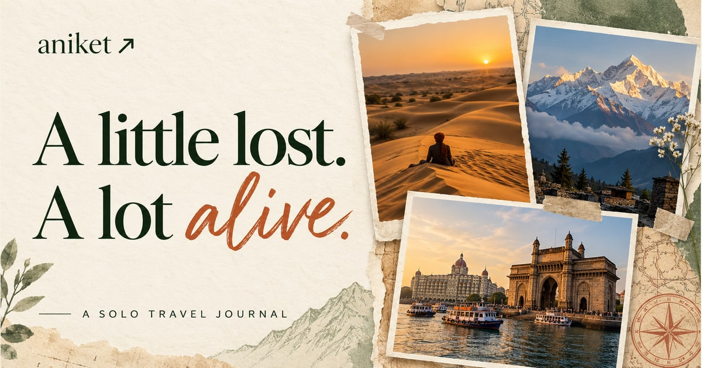

# The Wandering Soul — Aniket

A solo travel portfolio that reads like a journal: warm paper, layered postcards, moving landscapes, and stories about the places you see and the things you feel.

[Visit the website](https://the-wandering-soul.vercel.app/)



## The experience

- **Aniket’s Little World:** scroll through 12 scenic views across Mumbai, Jaisalmer, Kedarnath, and an imagined Karakoram dream chapter. Slow zoom, camera drift, and transitions create movement from local images; this is not generated video.
- **Wish you were here:** tilted postcard covers open on the exact image clicked, followed by three photo-story moments for each destination. Photos remain uncropped, with a frosted, blurred version of the image filling the background.
- **Through my eyes:** every moment pairs “What I saw” with “How it felt.” Browse with thumbnails, arrow buttons, keyboard arrows, or a horizontal swipe. Escape closes the viewer.
- **The unwritten chapter:** a cinematic destination explorer reveals Spiti Valley, Kerala, or Meghalaya through three feelings: a little higher, a little slower, or a little wilder. Visitors can leave a pin for the next adventure.
- **Made for phones:** compact headings, sticky navigation, full-screen photo stories, safe-area spacing, and touch-friendly controls. Reduced-motion preferences are respected.
- **Ready to share:** a branded WhatsApp/Open Graph cover, sharing text, Chrome tab icons, and home-screen icons.

The journal blends real places with illustrative personal writing. AI-created scenes are imagined views, not records of completed trips. K2 remains a dream chapter, not a summit claim.

## Run locally

Use **Node.js 24.x** and npm. Install the locked dependencies, then start the development server:

```sh
npm ci
npm run dev
```

Build and inspect the production version:

```sh
npm run build
npm run preview
```

`npm run build` also runs the production checker. It verifies the app entry point, sharing metadata, filename casing, image files, photo-story data, browser icons, and Vercel output configuration. Run the checker again against an existing build with `npm run check`.

## Deploy on Vercel

Import this repository and use its root directory. The included `vercel.json` supplies the deployment settings:

| Setting | Value |
| --- | --- |
| Framework | Vite |
| Node.js | 24.x |
| Install command | `npm ci --include=dev` |
| Build command | `npm run build` |
| Output directory | `dist` |

No API keys, database, or paid video service are required. Destination pins are saved only in the visitor’s browser with `localStorage`.

Include `src/`, `public/`, `scripts/`, `index.html`, `package.json`, `package-lock.json`, `vite.config.js`, and `vercel.json`. Local dependencies, verification folders, ZIP exports, and old hosting metadata are excluded from Vercel uploads by `.vercelignore`.

SPA rewrites support direct requests. The travel chapters use fragment links such as `/#jaisalmer`. After deployment, check the live site and its public image URLs.

## WhatsApp previews and browser icons

The default production URL is **https://the-wandering-soul.vercel.app**.

`index.html` includes sharing metadata in the initial HTML, so link-preview crawlers do not need to execute React. The cover is `public/social-preview.jpg`, a 1200 × 630 JPEG. SVG, ICO, PNG, and Apple touch icons are also included.

`vite.config.js` chooses the public origin in this order:

1. `SITE_URL`, if you set it for a custom domain.
2. `VERCEL_PROJECT_PRODUCTION_URL`.
3. `VERCEL_URL`.
4. The default production URL above.

For a new custom domain, set `SITE_URL` and redeploy. The sharing image must be public. WhatsApp and browsers can temporarily retain older previews or favicons after an update. See [Vercel’s production-domain variable](https://vercel.com/docs/environment-variables/system-environment-variables#vercel_project_production_url).

## Project structure

```text
src/
  main.jsx             Page layout and postcard collection
  ScrollJourney.jsx    Scroll progress and chapter copy
  PhotoWorld.jsx       Canvas-based scenic animation
  MemoryGallery.jsx    Accessible full-image photo-story viewer
  memories.js          Photo captions and journal passages
  HorizonEnding.jsx    Destination explorer and local pinning
public/
  images/              Local photos and optimized scene images
  social-preview.jpg   Sharing cover
  favicon.*            Browser tab logo
scripts/
  verify-build.mjs     Production validation
vite.config.js         Public URL and sharing metadata substitution
vercel.json            Vercel deployment configuration
```

## Images and credits

All runtime travel images are served locally. PNG originals accompany the journal images, with optimized WebP, phone, and thumbnail versions to reduce downloads. Upcoming destination artwork is supplied as WebP.

- **Mumbai Gateway photograph:** [Prado on Unsplash](https://unsplash.com/photos/people-walking-on-arch-gate-during-daytime-5EI5JYMSvj8), converted to PNG and WebP.
- **Kedarnath photograph:** [Unsplash destination collection](https://unsplash.com/s/photos/kedarnath), source image `photo-1712733900711-d0b929d0d7cc`, converted to PNG and WebP.
- **Other scenic, detail, future-destination, and sharing artwork:** AI-created illustrations for this portfolio. These are not documentary records of Aniket’s travels.
- **Typography:** Manrope, DM Sans, and Caveat from Google Fonts, with system-font fallbacks.
- **Icons:** Lucide.

Built with React, Vite, CSS, and Canvas.
